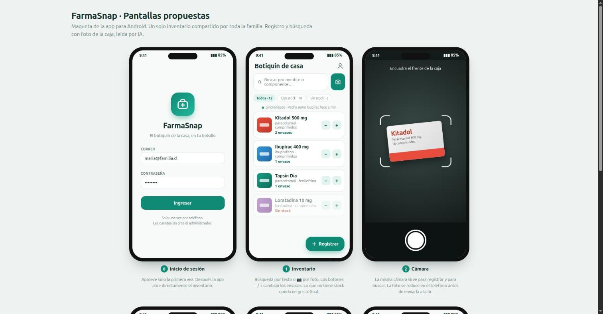
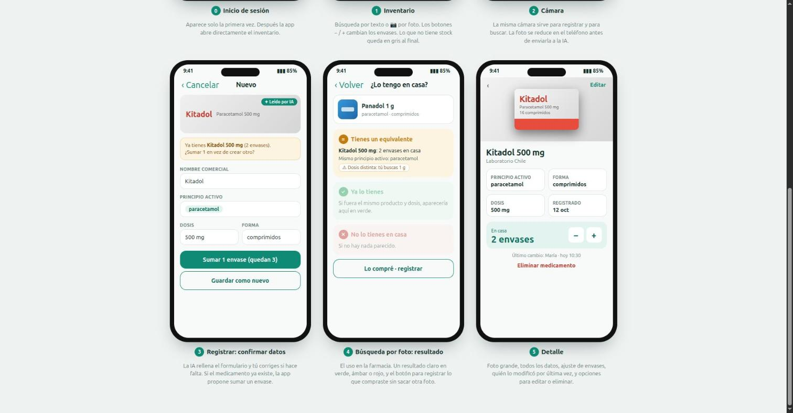

# FarmaSnap

App móvil familiar para saber, **antes de comprar un medicamento, si ya lo tienen en casa**.

Se fotografía la caja, la IA lee el nombre comercial, el principio activo y la dosis, y el
medicamento queda registrado en un inventario compartido por toda la familia. En la
farmacia, una foto de la caja (o una búsqueda por texto) indica si ya lo tienen, si tienen
un equivalente o si no lo tienen.

> **Estado:** diseño. Aún no hay código de la aplicación.

## Arquitectura

```
App Expo (Android, TypeScript)
   │
   ▼
Supabase
   • Auth ........ cuentas creadas por el administrador
   • Postgres .... inventario compartido (tabla `medicamentos`, RLS)
   • Storage ..... fotos de las cajas
   • Realtime .... cambios en vivo entre teléfonos
   • Edge Function `analizar-foto` ──► Claude Haiku 5.5
```

| Pieza | Tecnología |
|---|---|
| App móvil | Expo (React Native) + TypeScript + Expo Router |
| Backend | Supabase (Auth, Postgres, Storage, Realtime, Edge Functions) |
| Lectura de cajas | Claude Haiku 5.5 con salida estructurada |
| Compilación | EAS Build (nube): no requiere Android Studio |

## Documentación

- [Especificación de diseño](docs/superpowers/specs/2026-10-18-farmasnap-design.md)
- [Maquetas de pantallas](docs/mockups/): imágenes y `pantallas.html`



